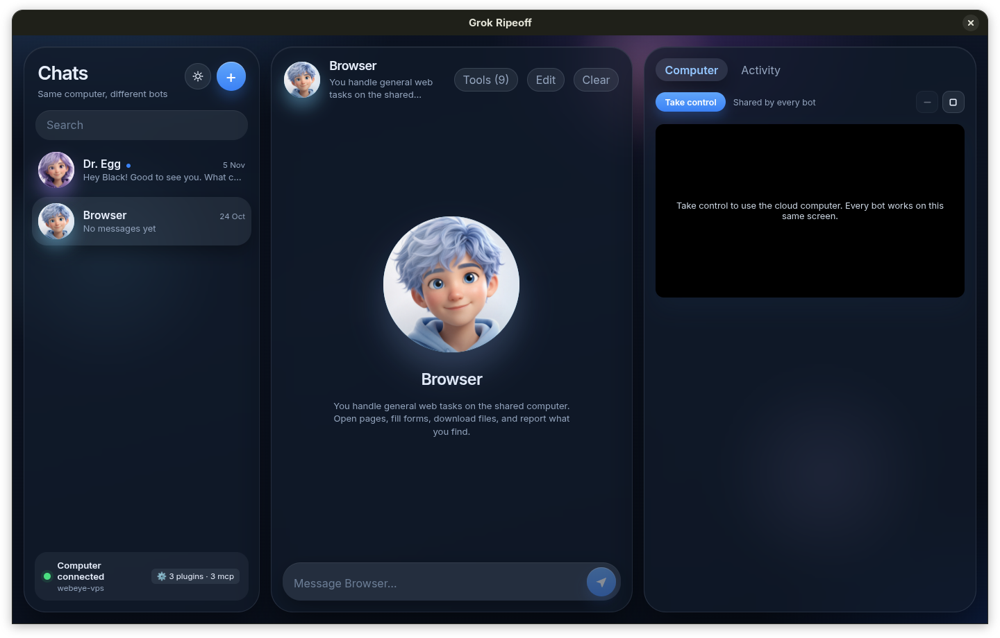

# Grok Ripeoff

An autonomous multi-bot assistant pairing local Python plugins and Model Context Protocol (MCP) servers with a shared remote cloud computer.



---

## Overview

**Grok Ripeoff** is an Electron and FastAPI application designed for agentic workflows. It connects multiple autonomous bot personas to:
1. **Your Local Machine**: Running local Python plugins and MCP servers directly on your laptop (file access, notes, clipboard, system telemetry).
2. **A Remote Cloud Computer**: Controlling a headless browser and desktop environment over an encrypted SSH tunnel with live VNC view and interactive takeover.

---

## Key Features

### 🧩 Local Plugins System
Built-in plugins execute locally in Python with zero external dependencies:
- **Local Files (`local_files`)**: Search, read, and list files and folders on your machine, guarded by built-in security blocks preventing access to private keys (`~/.ssh`, `~/.gnupg`, etc.).
- **Local Notes (`local_notes`)**: Create, list, and read personal markdown scratchpad notes stored in your isolated user data directory.
- **Local System (`local_system`)**: Access CPU/RAM stats and native Wayland/X11 clipboard reading and writing (`wl-copy`/`wl-paste`, `xclip`).
- **Extensible**: Simply drop any `.py` plugin into `plugins/` or `~/.local/share/grok-ripeoff/user-data/plugins/` and hit **Reload Plugins**.

### 🔌 Model Context Protocol (MCP) Support
Native MCP client supporting both:
- **Local stdio servers**: Spawns processes (e.g. `npx`, `python`) communicating via JSON-RPC 2.0 (e.g. `notion-mcp-server`, `youtube-mcp`).
- **Remote HTTP / SSE servers**: Connects over Streamed HTTP / SSE (e.g. `https://huggingface.co/mcp`).
- **In-App Management**: Dedicated **Tools Modal** in the chat interface to inspect active tools, view statuses, and add or delete MCP servers on the fly.

### 🛡️ Zero-Leak Credential Sanitization
- Active regex sanitizer (`bridge/sanitize.py`) intercepts all tool outputs, activity logs, and chat messages.
- Automatically redacts API keys and tokens (`sk-*`, `hf_*`, `ntn_*`, Bearer tokens, private keys) before they can ever reach the LLM prompt, the chat UI, or outbound network calls.

### 🖥️ Shared Cloud Computer & Live Takeover
- Every bot shares the same remote cloud computer on the right panel.
- Live VNC screen viewing with instant **Take control** handoff when manual intervention (CAPTCHAs, logins) is required.
- Human-in-the-loop root command approval gate.

### 📦 Clean Data Isolation & Production Versioning
- **User Data Isolation**: User data (`bots.json`, `notes/`, `mcp_servers.json`, session caches) is kept strictly in `~/.local/share/grok-ripeoff/user-data/`, completely separated from application binaries.
- **Atomic Version Upgrades**: Packaged versions live in `~/.local/share/grok-ripeoff/versions/v1` and are linked atomically to `current`, ensuring zero risk of data loss during updates.

---

## Project Structure

```
├── agent/            # Remote agent server running on cloud VPS (Playwright, VNC, root-gate)
├── app/              # Desktop Electron + React + TypeScript frontend
│   ├── src/          # React components, chat threads, live desktop viewer
│   └── electron/     # Electron main and preload processes
├── bridge/           # Local Python orchestrator & API bridge
│   ├── agent.py      # Local tool orchestrator (Plugins + MCP + Cloud VPS)
│   ├── mcp.py        # Stdio & HTTP Model Context Protocol client
│   ├── plugins.py    # Local Python plugin loader and registry
│   └── sanitize.py   # Outbound & prompt credential sanitizer
├── docs/             # Documentation and screenshots
│   └── assets/       # UI screenshots and visual assets
├── plugins/          # Built-in local plugins (files, notes, system)
└── scripts/          # Packaging, launching, and deployment scripts
```

---

## Getting Started

### Prerequisites
- **Node.js**: v18+ & npm
- **Python**: 3.10+
- **Linux**: Wayland or X11 desktop environment

### Installation & Packaging

1. Install frontend dependencies:
   ```bash
   cd app && npm install
   ```

2. Package into version 1:
   ```bash
   bash scripts/package-version.sh v1
   ```

3. Install desktop launcher and icon:
   ```bash
   bash scripts/install-desktop-entry.sh
   ```

You can now launch **Grok Ripeoff** directly from your application launcher or dock, or by running `grok-ripeoff` in your terminal.
